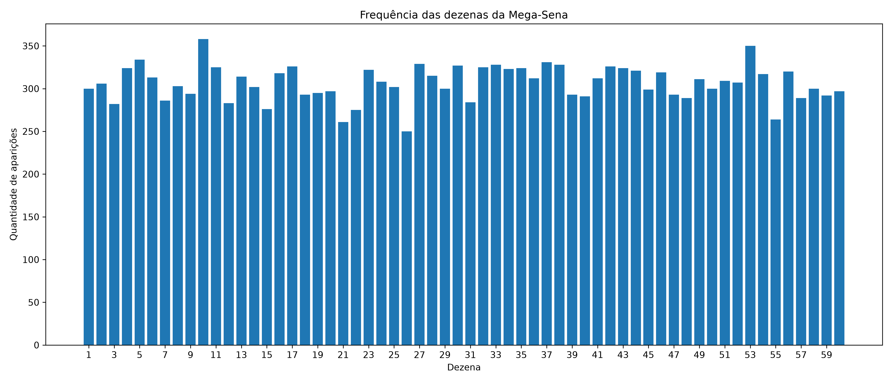
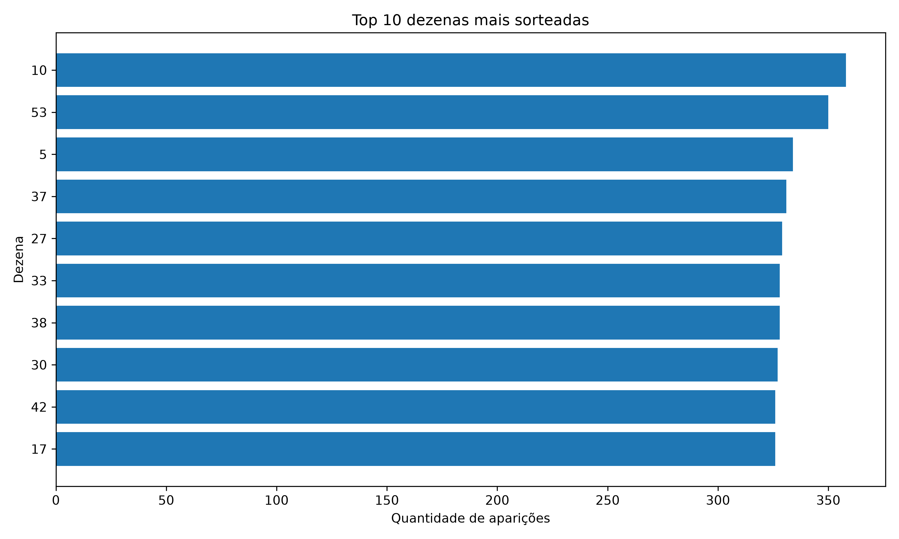
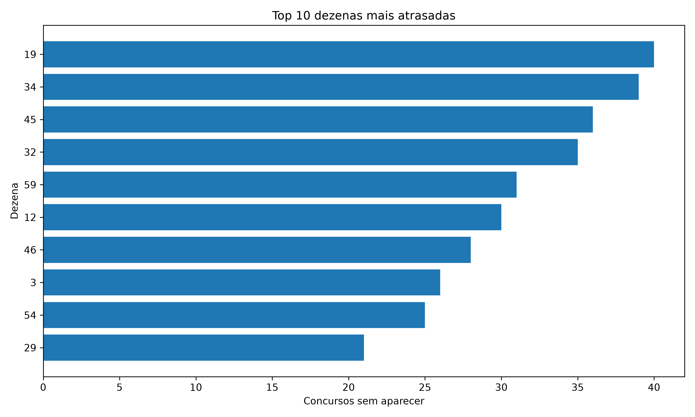
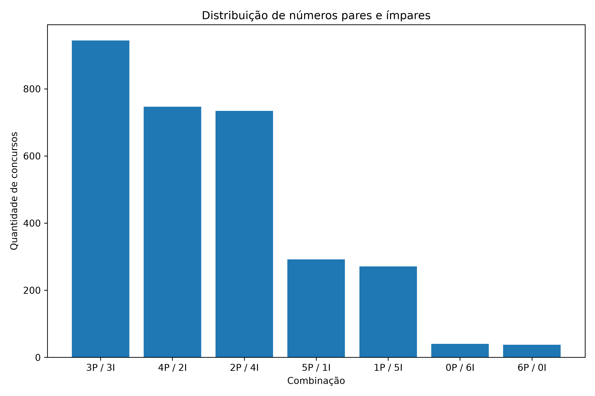
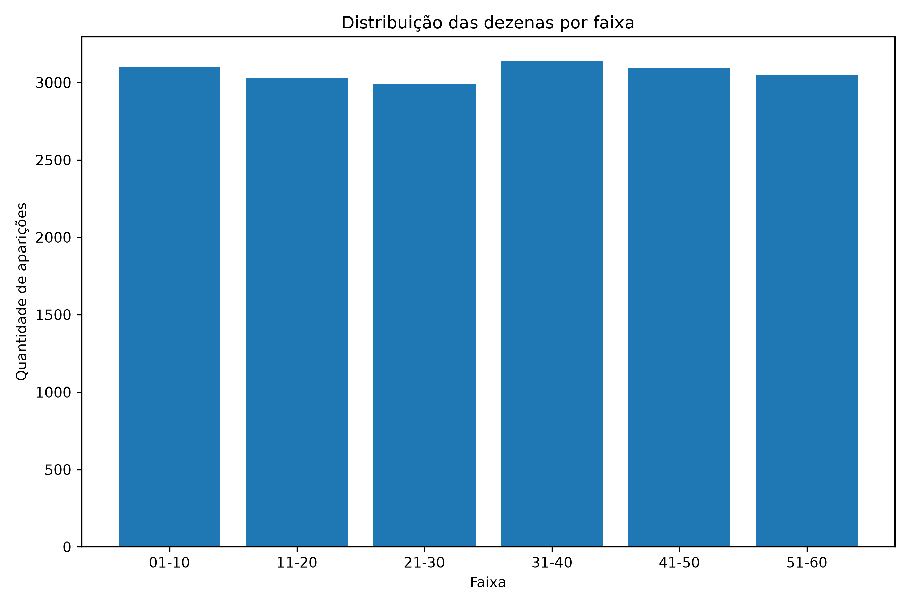
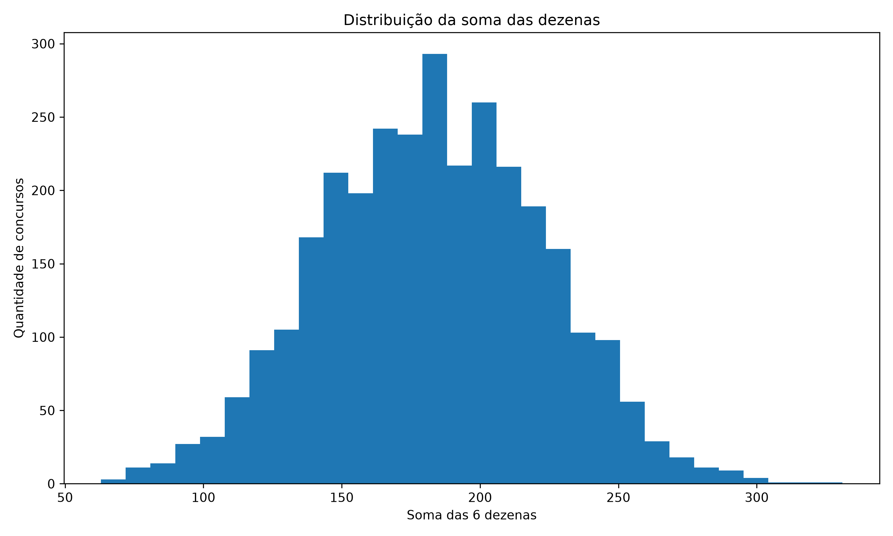

# 🎰 MegaData — Análise Estatística da Mega-Sena

Projeto de análise de dados desenvolvido em **Python** para explorar os resultados históricos da Mega-Sena.

O MegaData realiza tratamento e validação dos dados, análises estatísticas, visualizações interativas, geração experimental de combinações e backtesting de diferentes estratégias.

O objetivo do projeto não é prever resultados lotéricos, mas demonstrar na prática conceitos de **Python, análise de dados, estatística, visualização, testes retrospectivos e desenvolvimento de dashboards**.

---

## 📊 Visão geral

A versão atual do projeto utiliza os resultados históricos até o **concurso 3066**.

- 🎯 **3.066 concursos analisados**
- 🔢 **18.396 dezenas processadas**
- 📅 Dados entre **1996 e 2026**
- 📊 Dashboard interativo
- 🎲 Gerador experimental de jogos
- 🧪 Sistema de backtesting
- 📈 Análises estatísticas automáticas

---

## 🚀 Funcionalidades

### 📥 Tratamento dos dados

O projeto lê um arquivo Excel contendo o histórico dos concursos e executa automaticamente:

- validação das colunas;
- tratamento de datas;
- conversão das dezenas;
- detecção de valores inválidos;
- verificação de dezenas fora do intervalo 1–60;
- identificação de concursos duplicados;
- verificação de dezenas repetidas;
- geração de dataset tratado em CSV.

Fluxo:

```text
Excel original
      ↓
Leitura com Pandas
      ↓
Validação
      ↓
Limpeza
      ↓
Dataset tratado
```

---

## 📈 Análises estatísticas

O MegaData calcula diversas informações sobre os sorteios históricos.

Entre elas:

- frequência das 60 dezenas;
- dezenas mais sorteadas;
- dezenas menos sorteadas;
- dezenas mais atrasadas;
- distribuição entre pares e ímpares;
- distribuição entre números de 1–30 e 31–60;
- distribuição por faixas;
- soma das dezenas;
- média;
- mediana;
- mínimo;
- máximo;
- desvio padrão.

---

## 🔢 Análise individual das dezenas

O dashboard permite selecionar qualquer dezena entre **01 e 60**.

Para cada número são apresentados:

- quantidade de aparições;
- percentual de concursos;
- último concurso em que apareceu;
- atraso atual;
- histórico de aparições.

---

## 🎲 Gerador experimental

O projeto possui três formas de geração de combinações.

### 1. Aleatório

Seleciona seis dezenas de forma completamente aleatória.

### 2. Frequência histórica

Utiliza a frequência histórica de cada dezena como peso para a seleção.

### 3. Estatístico com filtros

Utiliza frequência histórica combinada com alguns filtros:

- quantidade de pares e ímpares;
- quantidade de dezenas entre 01–30 e 31–60;
- intervalo de soma das dezenas.

> Os filtros não significam aumento garantido da probabilidade de acerto.

---

## 🧪 Backtesting

O projeto possui um sistema de **backtesting histórico** para comparar os diferentes métodos.

O sistema simula o seguinte processo:

```text
Concursos 1 até 100
        ↓
Gera jogos
        ↓
Compara com concurso 101

Concursos 1 até 101
        ↓
Gera novos jogos
        ↓
Compara com concurso 102

Concursos 1 até 102
        ↓
...
```

Dessa forma, cada teste utiliza apenas informações que existiam **antes do concurso analisado**.

Isso evita o problema conhecido como:

**Data Leakage (vazamento de dados futuros).**

São comparados:

```text
Aleatório
      VS
Frequência histórica
      VS
Estatístico com filtros
```

O sistema registra quantos jogos tiveram:

- 0 acertos;
- 1 acerto;
- 2 acertos;
- 3 acertos;
- 4 acertos;
- 5 acertos;
- 6 acertos.

Também calcula a média de acertos de cada estratégia.

---

## 🖥️ Dashboard

A interface foi desenvolvida utilizando **Streamlit** e **Plotly**.

O dashboard possui as seguintes áreas:

```text
🏠 Visão Geral
🔢 Dezenas
📊 Estatísticas
🎲 Gerador
🧪 Backtest
ℹ️ Sobre
```

### Visão Geral

Apresenta os principais indicadores do dataset e a frequência histórica das dezenas.

### Dezenas

Permite analisar individualmente qualquer número entre 01 e 60.

### Estatísticas

Apresenta gráficos sobre:

- pares e ímpares;
- distribuição por faixas;
- soma das dezenas;
- dezenas atrasadas.

### Gerador

Permite gerar combinações utilizando os três métodos disponíveis.

### Backtest

Exibe a comparação histórica entre os métodos.

---

## 📸 Visualizações

### Frequência das dezenas



### Top 10 dezenas mais sorteadas



### Dezenas mais atrasadas



### Distribuição entre pares e ímpares



### Distribuição por faixas



### Distribuição da soma das dezenas



---

## 🛠️ Tecnologias utilizadas

- Python
- Pandas
- NumPy
- Matplotlib
- Plotly
- Streamlit
- OpenPyXL
- Git
- GitHub

---

# ⚙️ Como executar

## 1. Clonar o repositório

```bash
git clone https://github.com/RoninXK/megadata-megasena.git
```

Entre na pasta:

```bash
cd megadata-megasena
```

---

## 2. Criar ambiente virtual

### Windows

```bash
python -m venv .venv
```

Ative:

```bash
.venv\Scripts\activate
```

---

## 3. Instalar dependências

```bash
pip install -r requirements.txt
```

---

## 4. Adicionar o dataset

O arquivo Excel original não é distribuído neste repositório.

Coloque o arquivo:

```text
mega_sena_asloterias_ate_concurso_3066_sorteio.xlsx
```

dentro de:

```text
data/raw/
```

A base utilizada neste projeto foi obtida a partir do histórico disponibilizado pelo site **As Loterias**.

---

## 5. Processar os dados

Execute:

```bash
python src/tratamento.py
```

O programa irá gerar:

```text
data/processed/mega_sena_tratada.csv
```

---

## 6. Executar as análises

```bash
python src/estatisticas.py
```

---

## 7. Gerar os gráficos

```bash
python src/graficos.py
```

---

## 8. Executar o backtest

```bash
python src/backtest.py
```

---

## 9. Iniciar o dashboard

```bash
python -m streamlit run app.py
```

O Streamlit abrirá a aplicação no navegador.

Normalmente:

```text
http://localhost:8501
```

---

# 🔄 Pipeline do projeto

```text
Arquivo Excel
     │
     ▼
┌────────────────────┐
│   Tratamento       │
│   tratamento.py    │
└─────────┬──────────┘
          │
          ▼
┌────────────────────┐
│ Dataset tratado    │
└─────────┬──────────┘
          │
          ├───────────────────┐
          │                   │
          ▼                   ▼
┌─────────────────┐   ┌─────────────────┐
│ Estatísticas    │   │   Backtesting   │
│ estatisticas.py │   │   backtest.py   │
└────────┬────────┘   └────────┬────────┘
         │                     │
         └──────────┬──────────┘
                    │
                    ▼
             ┌──────────────┐
             │  Dashboard   │
             │  Streamlit   │
             └──────────────┘
```

---

# 📚 Conceitos aplicados

Durante o desenvolvimento deste projeto foram utilizados conceitos de:

### Engenharia e tratamento de dados

- leitura de Excel;
- limpeza de dados;
- validação;
- transformação;
- geração de datasets processados.

### Análise de dados

- análise exploratória;
- frequência;
- agrupamento;
- estatística descritiva.

### Visualização

- gráficos de barras;
- histogramas;
- gráficos interativos;
- dashboard.

### Programação

- funções;
- estruturas condicionais;
- loops;
- manipulação de arquivos;
- organização modular do código.

### Testes retrospectivos

- backtesting;
- comparação de estratégias;
- prevenção de data leakage.

### Versionamento

- Git;
- GitHub;
- commits;
- organização de repositório.

---

# 🗺️ Próximas melhorias

O projeto continuará sendo desenvolvido.

Próximas etapas planejadas:

- [ ] adicionar Machine Learning;
- [ ] comparar Machine Learning com os métodos atuais;
- [ ] implementar análise de pares de dezenas;
- [ ] analisar trincas mais frequentes;
- [ ] analisar números consecutivos;
- [ ] analisar repetição entre concursos;
- [ ] adicionar testes automatizados com Pytest;
- [ ] melhorar a interface;
- [ ] automatizar atualização da base;
- [ ] disponibilizar o dashboard online.

---

# 👨‍💻 Autor
Flávio Ferreira Alves

GitHub:

**https://github.com/RoninXK**

---

## ⭐ Sobre o projeto

O MegaData foi desenvolvido como projeto de portfólio com o objetivo de demonstrar conhecimentos em:

**Python | Data Analysis | Pandas | Estatística | Data Visualization | Streamlit | Plotly | Backtesting | Git | GitHub**